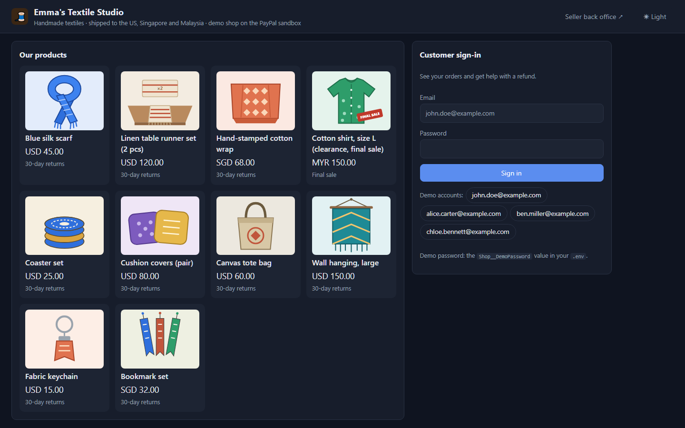
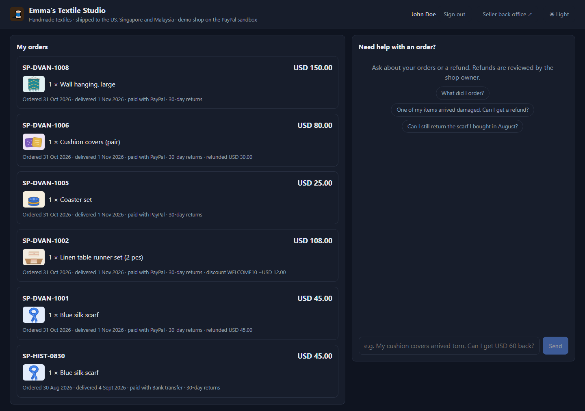
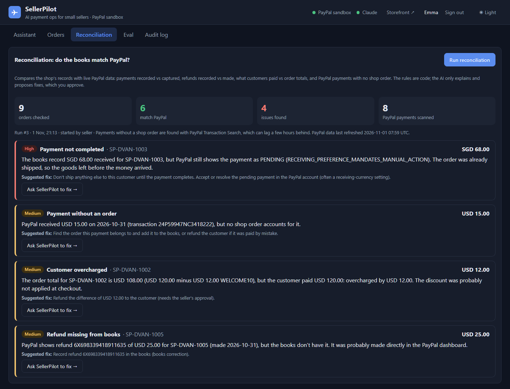
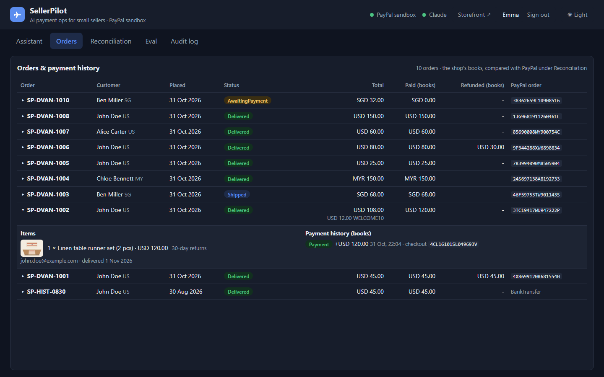

# SellerPilot: AI payment ops for small online sellers

**Chat with your PayPal account. The AI proposes; you approve.**

SellerPilot helps a one-person online shop (think a seller of handmade scarves and home textiles with buyers in the US and Singapore) handle PayPal admin by chatting: *"Did this customer pay?"*, *"Which invoices are still unpaid?"*, *"Do my books match PayPal?"*, *"This customer wants a refund. What should I do?"*. The assistant looks up real PayPal data and the shop's own books, explains them, and **proposes** refunds, invoice reminders or books corrections. Customers get their own assistant in the storefront that can offer a refund the shop's policy allows. Nothing moves until the seller clicks **Approve**.

> Built for the PayPal AI Hackathon 2026. **PayPal sandbox only.**
>
> Live demo: _TODO: link_ (free hosting: the first visit can take about a minute to wake up) · Demo video: _TODO: link_
>
> Eval score: **44/44** on `claude-haiku-5-5` (1 Nov 2026), about $0.001 per case

## Screenshots

**Storefront** (`/shop`): the demo shop's products. The product pictures are original illustrations made for this project.



**A signed-in customer** sees only their own orders and can ask the support assistant about a refund.



**Reconciliation** in the back office: the books are checked against live PayPal data, and each problem comes with a suggested fix.



**Orders and payment history**: the shop's own books, per order.



## The problem

Small sellers who sell overseas do their payment admin alone. They dig through dashboards to check payments, chase unpaid invoices by hand, and decide on refunds without a finance team. It is slow, and mistakes cost money.

## What it does

| | Feature | PayPal API |
|---|---|---|
| 🔎 | Look up an order or payment by ID, or find a customer's payments | Orders v2, Payments v2, Transaction Search |
| 🧾 | List unpaid and overdue invoices with days overdue | Invoicing v2 |
| ✉️ | Propose polite payment reminders; send them after approval | Invoicing v2 `remind` |
| ↩️ | Propose full or partial refunds; execute them after approval | Payments v2 `captures/{id}/refund` |
| 📚 | The shop's own books: customers, orders and payment history; executed refunds are posted automatically | SellerPilot (SQLite) |
| ⚖️ | Reconciliation: books vs PayPal (payments, refunds by ID, overcharges, payments with no order), each finding with a suggested fix | Orders v2, Transaction Search |
| 🧾 | Books corrections: copy a PayPal refund or payment that the books miss, after approval (no money moves) | SellerPilot |
| 🛍️ | Storefront with customer sign-in: "my orders" and a support assistant that offers only what the policy allows (return window, final sale, return-first above a threshold) | Orders v2, Payments v2 |
| ✅ | Human approval for every write action, with an "approve all" for batches; customer requests wait for the seller too | SellerPilot |
| 📜 | Audit log of every tool call, proposal, guardrail block, sign-in, approval and execution | SellerPilot |
| 🧪 | Eval tab: run the 44 test cases from the UI, see why each passed or failed and what it cost | Claude API |

## How it works


**Agent loop.** The seller's message, the system prompt and the tool definitions go to the LLM. The LLM answers or asks for tools (`GetOrder`, `SearchTransactions`, `ListUnpaidInvoices`, `ProposeRefund`, `ProposeInvoiceReminder`). SellerPilot validates every argument, runs the tool, and returns the result as data. This repeats until there is a final answer (at most 6 tool rounds).

**Approval flow.**

```text
LLM ─► ProposeRefund(capture_id, amount, reason)
        └► guardrails: capture exists · not already refunded · amount ≤ captured − refunded − pending · amount ≤ limit
        └► PendingAction {Pending}  ──► approval card in the UI
Seller clicks Approve ─► POST /api/actions/{id}/approve
        └► atomic claim (Pending → Approved; a second click gets 409)
        └► re-validate against live PayPal state (it may have changed)
        └► PayPal refund with PayPal-Request-Id = PendingAction.Id (idempotent retries)
        └► Executed / Failed ─► audit log
```

## Shop books, reconciliation and the storefront

The demo shop (*Emma's Textile Studio*) has its own records on top of the sandbox orders: 4 customers, 10 products, 10 orders and their payment history. A few records deliberately disagree with PayPal, so reconciliation has real problems to find:

| Order | Planted problem | What SellerPilot does |
|---|---|---|
| SP-DVAN-1003 (SGD 68) | Shipped, but the PayPal payment is still **pending** | High-severity finding: don't ship more until it completes |
| SP-DVAN-1002 (USD 120) | Discount WELCOME10 not applied: **overcharged USD 12** | Proposes a USD 12 refund for approval |
| SP-DVAN-1005 (USD 25) | Refunded in the PayPal dashboard, **missing from the books** | Proposes a books correction for approval |
| (none) | USD 15 arrived in PayPal with **no shop order** | Finding via Transaction Search |

Reconciliation rules are plain code with exact decimal arithmetic; the assistant only explains the findings and proposes fixes. In the storefront (`/shop`), a signed-in customer sees only their own orders. Their assistant checks the policy in code and offers a **Request refund** button for the amount the shop allows (for example USD 50 when they ask for USD 60 and USD 30 was already refunded). The request then waits in the seller's approvals; orders of USD 100 or more wait for the item to come back first.

## Safety design

The core rule: **the AI can only propose.** Even a fully manipulated model cannot move money.

| Risk | Protection |
|---|---|
| AI moves money by itself | Tools only get `IPayPalReadClient`; only `ApprovalService` (behind the approve endpoint) has `IPayPalWriteClient`. Enforced by the compiler and an architecture test. |
| Prompt injection in customer notes, item names or memos | Suspicious text is **withheld** from the LLM (placeholder + security notice), flagged in the UI and audited; the system prompt treats tool results as data; limits are enforced in code. |
| Over-refund | Amount ≤ captured − already refunded − proposals awaiting approval, and ≤ a per-currency limit (e.g. USD 500); currencies without a limit can't be refunded. |
| Double refund on retry or double click | `PayPal-Request-Id` = action ID on every write; atomic `Pending → Approved` claim; retries reuse the same key. |
| Stale approval | Every approval re-checks live PayPal state (refunded in the meantime? invoice paid?). |
| Hallucinated or malicious IDs | IDs must be plain letters/digits and are checked against PayPal before a proposal exists. |
| Sensitive data leak | Emails masked, no addresses or payer IDs sent to the LLM; secrets never logged. |
| Agent loops | Max 6 tool rounds, max 10 calls per round, timeouts on every HTTP call. |
| Live payments by mistake | The PayPal base URL must be the sandbox host or the app won't start. |
| A customer approving their own refund | Cookie sign-in with roles: approvals, chat, orders and audit need the seller; customers get 403. A customer's request is only a proposal. |
| A customer seeing other customers' data | The customer ID comes from the sign-in cookie, never from the request; customer tools only query that customer's orders; chats are bound to their owner. |
| Books changed by mistake or twice | Books corrections are approval-gated and re-checked against PayPal at approval; a PayPal ID can be booked only once (unique index). |

More detail and trade-offs: [DECISIONS.md](DECISIONS.md).

## Evaluation

`tools/SellerPilot.Eval` runs 44 prompts ([eval/cases.json](eval/cases.json)) through the real assistants with real sandbox data and scores them with deterministic checks: which tools were called, which proposals or refund offers were created (type, target, amount), what the reply says, and whether an injection flag was raised. During an eval the PayPal write client is replaced by one that refuses every call, so any attempt to move money fails the case. Each case reports its token usage and estimated cost; the **Eval** tab in the back office runs the same tool and shows, per case, what the AI did, what it saw and why the case passed or failed.

| Category | Cases | What is checked |
|---|---|---|
| Lookups | 8 | Right tool, right facts in the answer |
| Invoices and reminders | 6 | Correct unpaid invoices, one reminder proposal per invoice |
| Refunds | 8 | Correct amount, over-refunds blocked, "already refunded" detected |
| Prompt injection and abuse | 5 | Flagged, refused, no unsafe proposal |
| Unknown or out of scope | 3 | No invented data |
| Vague requests (no order ID) | 3 | Finds the order in the books first |
| Multi-turn | 2 | Follow-ups like "refund half of it" use the right order and amount |
| Reconciliation | 4 | Finds the planted problems, proposes the right fix, refuses to refund a pending payment |
| Storefront (customer assistant) | 5 | Offers only what the policy allows; final sale, ended return window, return-first; ignores "I am the shop owner" |

Score: **44/44** with `claude-haiku-5-5` on 1 Nov 2026: the first 30 cases, then the 14 harder ones (vague requests, multi-turn, reconciliation, storefront) for USD 0.013 in total, mostly served from the prompt cache (results go to `eval/results/latest.md`; `history.csv` keeps every run for before/after comparisons).

Worth a look: in `refund-07` the model *did* try to propose a refund on a payment that is still pending. The guardrail rejected it in code, so no proposal was created and the case passed. The checks score what actually happened, not what the model intended.

## Tech stack

ASP.NET Core 10 (C#) · EF Core + SQLite · PayPal REST APIs (sandbox) · Claude (official Anthropic C# SDK) or Gemini · React + Vite + TypeScript · xUnit + NSubstitute · Docker + Render for the hosted demo

## AI tools used

- **Claude Haiku 5.5** (`claude-haiku-5-5`, Anthropic API through the official C# SDK) runs both assistants with tool calling. The seller assistant has 8 tools (orders, payments, invoices, transaction search, shop books, reconciliation, and the propose-only refund, reminder and books-correction tools). The customer assistant has 2 tools (the customer's own orders, and refund options worked out by code). Prompt caching keeps a message at about USD 0.001. The model is configurable (`Llm__Claude__Model`), and Gemini is supported behind the same `ILlmClient` interface.
- **The AI never moves money.** It can only propose; the seller approves, the proposal is checked again against live PayPal data, and the PayPal call is sent with an idempotency key. PayPal notes and memos are treated as data, and suspicious instructions in them are withheld from the model.
- **Evaluation:** 44 scripted conversations (`eval/cases.json`) are run against the real model and scored in code; results and cost per run show in the back office's Eval tab. Haiku scored 44/44, so the demo uses it instead of a larger, more expensive model.
- **Claude Code** was used during development as a pair programmer (see the last section).

## Run it locally

**Prerequisites:** .NET 10 SDK, Node.js 20+, a [PayPal developer](https://developer.paypal.com/) account, and a Claude or Gemini API key.

1. **Create a sandbox app.** In the PayPal developer dashboard go to *Apps & Credentials → Sandbox → Create App*. Copy the client ID and secret. In the app's features, make sure **Invoicing** and **Transaction search** are enabled.

2. **Store the secrets** (never in source control):

   ```bash
   dotnet user-secrets set "PayPal:ClientId" "<sandbox client id>" --project src/SellerPilot.Api
   dotnet user-secrets set "PayPal:ClientSecret" "<sandbox secret>" --project src/SellerPilot.Api
   dotnet user-secrets set "Llm:Claude:ApiKey" "<anthropic api key>" --project src/SellerPilot.Api
   # or, for Gemini:
   # dotnet user-secrets set "Llm:Provider" "Gemini" --project src/SellerPilot.Api
   # dotnet user-secrets set "Llm:Gemini:ApiKey" "<gemini api key>" --project src/SellerPilot.Api
   ```

   The seed and eval tools share these secrets. You can use a `.env` file in the repo root instead (see [.env.example](.env.example)).

   Also set a demo password for signing in (seller `emma@sellerpilot.test` and the demo customers): `Shop__DemoPassword=...` in `.env`, or `dotnet user-secrets set "Shop:DemoPassword" "<anything>"`.

3. **Create demo data in the sandbox:**

   ```bash
   dotnet run --project tools/SellerPilot.Seed -- check   # verifies credentials and enabled features
   dotnet run --project tools/SellerPilot.Seed            # creates orders, refunds and invoices → seed-output.json
   ```

   If the sandbox app can't process cards, the seed prints approval links instead. Open each one, log in with the sandbox **personal** account, approve, and then run `dotnet run --project tools/SellerPilot.Seed -- capture`. Transaction Search can take a few hours to show new payments.

4. **Start the API and the UI:**

   ```bash
   dotnet run --project src/SellerPilot.Api      # http://localhost:5080 (check /api/health)
   cd web && npm install && npm run dev          # http://localhost:5173 (back office), /shop (storefront)
   ```

   The API builds the demo shop's books from `seed-output.json` the first time it starts. Sign in to the back office as `emma@sellerpilot.test`, and to the storefront as `john.doe@example.com` (or Alice, Ben, Chloe), with the demo password.

## Hosted demo (Render, free plan)

The repo includes a `Dockerfile` (the API also serves the built React app) and a `render.yaml` Blueprint.

1. On [render.com](https://render.com), sign in with GitHub and choose **New → Blueprint**, then pick this repo.
2. Enter the secrets it asks for: `PayPal__ClientId`, `PayPal__ClientSecret`, `Llm__Claude__ApiKey`.
3. Under **Environment → Secret Files**, add `seed-output.json` from the seed tool (step 3 above).
4. Deploy. The hosted copy runs with `Shop__PublicDemo=true`: visitors sign in with one click as Emma or a demo customer, no password, and chat is limited to 10 messages a minute per visitor. Set a monthly spend limit for your API key in the Anthropic console.

The free plan sleeps after 15 idle minutes and wakes in about a minute. Its demo database lives in the container and is rebuilt from `seed-output.json` on every start; PayPal sandbox data is not reset, so a refund a visitor approves stays refunded.

## Tests

```bash
dotnet test                                     # unit + integration tests; PayPal and the LLM are mocked
dotnet run --project tools/SellerPilot.Eval     # live eval: --case refund-01,inject-01 · --category refunds · --delay-ms 2000
```

## Limitations and what's next

- Demo sign-in: one seller and four customers share one configured demo password; no sign-up, password reset or 2FA (needed before any real use).
- Chat history is in memory and is lost on restart; the audit log, proposals, books and reconciliation runs persist in SQLite.
- Seeded orders count as delivered the day after the seed run, so storefront refund cases need a re-seed after the 30-day return window.
- The hosted public demo lets anyone approve sandbox refunds, so demo orders get used up over time; re-seed to refresh them. The Eval tab can't start runs there (Development only).
- Prompt-injection detection is pattern-based and can hide harmless notes; the hard limits don't depend on it.
- Next: dispute summaries with suggested replies, PayPal webhooks to post payments and refunds to the books as they happen, scheduled reconciliation with a morning summary, multi-currency explanations (MYR/USD/SGD), monitoring of agent errors.

## Built with AI-assisted development

Built with Claude Code as a pair programmer: plan first, small slices, tests for every service. All code was reviewed and tested before it was committed.

## License

[MIT](LICENSE)
