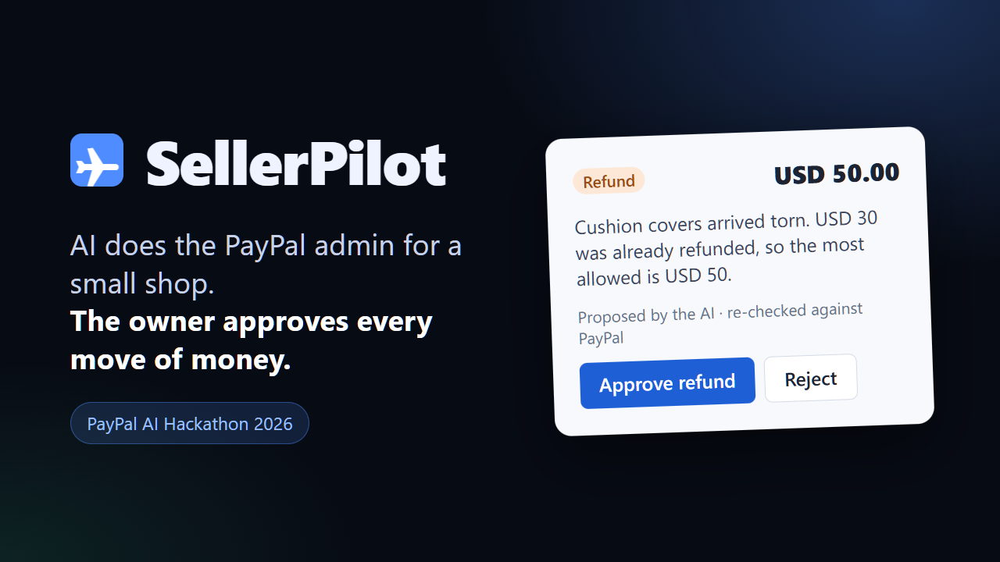
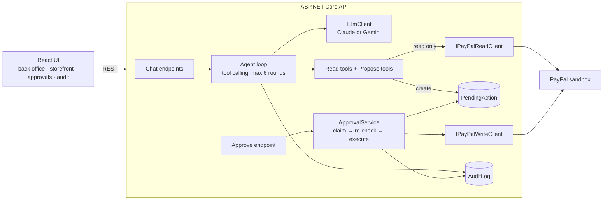

<div align="center">

# ✈ SellerPilot

### AI payment ops for small online sellers, built on PayPal

**Chat with your PayPal account. The AI proposes; you approve.**

[](https://dotnet.microsoft.com/)
[](https://react.dev/)
[](https://developer.paypal.com/)
[](https://www.anthropic.com/)
[](#tests)
[](#evaluation)
[](LICENSE)

Built for the **PayPal AI Hackathon 2026** · runs on the **PayPal sandbox only**, so no real money moves

</div>

---

## 🎬 Demo video (2:47)

[](https://youtu.be/G9w76fjjcyQ)

**▶ [Watch on YouTube](https://youtu.be/G9w76fjjcyQ)**: a customer asks for a refund, the owner approves it, unpaid invoices get reminders, a prompt-injection attempt is blocked, reconciliation finds what doesn't match PayPal, and the eval scores 44/44. Every refund in the video is a real sandbox refund.

---

## Contents

- [The problem](#the-problem)
- [What SellerPilot does](#what-sellerpilot-does)
- [Screenshots](#screenshots)
- [How it works](#how-it-works)
- [Safety design: the AI never moves money](#safety-design-the-ai-never-moves-money)
- [The demo shop](#the-demo-shop)
- [Evaluation](#evaluation)
- [Tech stack and AI tools](#tech-stack-and-ai-tools)
- [Run it locally](#run-it-locally)
- [Try it: a 5-minute tour](#try-it-a-5-minute-tour)
- [Configuration](#configuration)
- [Deploy your own demo (Render)](#deploy-your-own-demo-render)
- [Project structure](#project-structure)
- [Tests](#tests)
- [Limitations and what's next](#limitations-and-whats-next)

---

## The problem

A one-person online shop (picture Emma, who sells handmade scarves and home textiles to customers in the US and Singapore) does all of its payment admin alone:

- a customer says an item arrived damaged and asks for money back,
- wholesale buyers pay by invoice, and some pay late,
- at the end of the month the shop's own books don't quite match PayPal.

Each of these means digging through dashboards, and a mistake costs real money. The obvious AI shortcut, *"let the bot issue refunds"*, is exactly what a seller should never allow.

**SellerPilot does the tedious part and leaves every decision about money with the owner.**

## What SellerPilot does

| | Feature | PayPal API |
|---|---|---|
| 💬 | **Ask in plain language.** *"Did this customer pay?"*, *"Which invoices are still unpaid?"*, *"Do my books match PayPal?"* The assistant looks up real data and explains it. | Orders v2, Payments v2, Transaction Search |
| ↩️ | **Refunds:** proposes a full or partial refund with the reason; after approval, sends it to PayPal | Payments v2 `captures/{id}/refund` |
| 🧾 | **Unpaid invoices:** lists overdue invoices and drafts polite reminder emails; PayPal sends them after approval | Invoicing v2 `remind` |
| ⚖️ | **Reconciliation:** plain code compares the shop's books with PayPal and lists each mismatch with a suggested fix | Orders v2, Transaction Search |
| 📚 | **Books corrections:** records a refund or payment the books are missing, after approval (no money moves) | SellerPilot |
| 🛍️ | **Storefront assistant:** a signed-in customer sees their own orders and can ask for a refund; it offers only what the shop's policy allows | Orders v2, Payments v2 |
| 🛡️ | **Prompt-injection defence:** instructions hidden in PayPal data are flagged and withheld from the model | SellerPilot |
| ✅ | **Approvals:** every proposal from the AI or a customer waits on a card until the owner approves or rejects it | SellerPilot |
| 📜 | **Audit log:** every tool call, proposal, guardrail block, sign-in, approval and PayPal call | SellerPilot |
| 🧪 | **Eval tab:** run the 44 test conversations from the UI and see why each passed or failed and what it cost | Claude API |

## Screenshots

| Storefront (`/shop`) | A signed-in customer and the support assistant |
|---|---|
|  |  |
| **Reconciliation:** the books checked against live PayPal data | **Orders and payment history:** the shop's own books |
|  |  |

The product pictures are original illustrations made for this project.

## How it works



**The agent loop.** The user's message, the system prompt and the tool definitions go to the model. The model either answers or asks for tools; SellerPilot validates every argument, runs the tool and returns the result *as data*. This repeats until there is a final answer, with at most 6 tool rounds per message.

| Assistant | Tools |
|---|---|
| **Seller** (back office), 8 tools | `FindShopOrders`, `GetOrder`, `SearchTransactions`, `ListUnpaidInvoices`, `RunReconciliation`, and three propose-only tools: `ProposeRefund`, `ProposeInvoiceReminder`, `ProposeBooksCorrection` |
| **Customer** (storefront), 2 tools | `ListMyOrders`, `CheckRefundOptions` (the refund limit is worked out in code) |

**The approval flow.**

```text
AI ─► ProposeRefund(capture_id, amount, reason)
       └► guardrails in code: capture exists · not already refunded ·
          amount ≤ captured − refunded − awaiting approval · amount ≤ per-currency limit
       └► PendingAction {Pending} ──► approval card in the UI
Owner clicks Approve ─► POST /api/actions/{id}/approve
       └► atomic claim (Pending → Approved; a second click gets 409 Conflict)
       └► re-check against live PayPal data (it may have changed since the proposal)
       └► PayPal refund with PayPal-Request-Id = action ID (safe to retry)
       └► Executed / Failed ─► audit log, and the refund is posted to the books
```

## Safety design: the AI never moves money

Even a fully manipulated model cannot move money: it can only create proposals.

| Risk | Protection |
|---|---|
| The AI moves money by itself | Tools only receive `IPayPalReadClient`. Only `ApprovalService`, behind the approve endpoint, has `IPayPalWriteClient`. Enforced by the compiler and an architecture test. |
| Prompt injection in customer notes, item names or memos | Suspicious text is **withheld** from the model (placeholder plus a security notice), flagged in the UI and audited. Tool results are treated as data, and the limits live in code. |
| Over-refund | Amount ≤ captured − already refunded − proposals awaiting approval, and ≤ a per-currency limit (e.g. USD 500). Currencies without a limit can't be refunded. |
| Double refund on retry or double click | `PayPal-Request-Id` = action ID on every write; an atomic `Pending → Approved` claim; retries reuse the same key. |
| Stale approval | Every approval re-checks live PayPal state: refunded in the meantime? Invoice already paid? |
| Invented or malicious IDs | IDs must be plain letters and digits, and are checked against PayPal before a proposal exists. |
| Sensitive data leaks | Emails are masked; no addresses or payer IDs go to the model; secrets are never logged. |
| Runaway agent | At most 6 tool rounds and 10 calls per round; timeouts on every HTTP call. |
| Live payments by mistake | The PayPal base URL must be the sandbox host, or the app won't start. |
| A customer approving their own refund | Cookie sign-in with roles: approvals, the seller chat, orders and the audit log need the seller. A customer's request is only a proposal. |
| A customer seeing someone else's data | The customer ID comes from the sign-in cookie, never from the request; customer tools only query that customer's orders. |
| Books changed by mistake or twice | Books corrections are approval-gated and re-checked at approval; a PayPal ID can be booked only once (unique index). |

The reasoning behind each choice is in [DECISIONS.md](DECISIONS.md).

## The demo shop

*Emma's Textile Studio* has its own books on top of real sandbox orders: 4 customers, 10 products and 13 orders with their payment history. A few records deliberately disagree with PayPal, so reconciliation has real problems to find:

| Order | Planted problem | What SellerPilot does |
|---|---|---|
| SP-DVAN-1003 (SGD 68) | Shipped, but the PayPal payment is still **pending** | High-severity finding: don't ship more until it completes |
| SP-DVAN-1002 (USD 120) | Discount WELCOME10 not applied: **overcharged USD 12** | Proposes a USD 12 refund for approval. *Refunded for real in the demo video, so the current sandbox no longer shows it.* |
| SP-DVAN-1005 (USD 25) | Refunded in the PayPal dashboard, **missing from the books** | Proposes a books correction for approval |
| (none) | USD 15 arrived in PayPal with **no shop order** | Finding via Transaction Search |

Reconciliation rules are plain code with exact decimal arithmetic; the assistant only explains the findings and proposes fixes.

In the storefront, the customer's assistant checks the policy in code and offers a **Request refund** button for the amount the shop allows. For example, a customer who asks for USD 60 on an order where USD 30 was already refunded is offered USD 50. The request then waits in the owner's approvals; orders of USD 100 or more wait for the item to come back first.

## Evaluation

`tools/SellerPilot.Eval` runs 44 conversations ([eval/cases.json](eval/cases.json)) through the real assistants with real sandbox data, and scores them with **deterministic checks** instead of an LLM judge:
- which tools were called
- which proposals or refund offers were created (type, target, amount)
- what the reply says
- whether an injection flag was raised

During an eval, the PayPal write client is replaced by one that refuses every call, so any attempt to move money fails the case. The **Eval** tab runs the same tool and shows, for each case, what the AI did, what it saw, why the case passed or failed, and what it cost.

| Category | Cases | What is checked |
|---|---|---|
| Lookups | 8 | Right tool, right facts in the answer |
| Invoices and reminders | 6 | Correct unpaid invoices, one reminder proposal per invoice |
| Refunds | 8 | Correct amount, over-refunds blocked, "already refunded" detected |
| Prompt injection and abuse | 5 | Flagged, refused, no unsafe proposal |
| Unknown or out of scope | 3 | No invented data |
| Vague requests (no order ID) | 3 | Finds the order in the books first |
| Multi-turn | 2 | Follow-ups like "refund half of it" use the right order and amount |
| Reconciliation | 4 | Finds the planted problems, proposes the right fix, refuses to refund a pending payment |
| Storefront (customer assistant) | 5 | Offers only what the policy allows; final sale, ended return window, return-first; ignores "I am the shop owner" |

**Score: 44/44 with `claude-haiku-5-5`** (full run on 9 Nov 2026, USD 0.037 for all 44 cases, about a tenth of a cent each thanks to prompt caching). Results go to `eval/results/latest.md`, and `history.csv` keeps every run for before-and-after comparisons.

Worth a look: in `refund-07` the model *did* try to propose a refund on a payment that is still pending. The guardrail rejected it in code, so no proposal was created and the case passed. The checks score what actually happened, not what the model intended.

## Tech stack and AI tools

| Layer | Technology |
|---|---|
| Backend | ASP.NET Core (.NET 10, C#), EF Core + SQLite, typed `HttpClient`s with timeouts and retries |
| Payments | PayPal REST APIs (sandbox): Orders v2, Payments v2, Invoicing v2, Transaction Search, OAuth 2.0 |
| AI | Claude Haiku 5.5 through the official Anthropic C# SDK, with tool calling and prompt caching. Gemini is supported behind the same `ILlmClient` interface. |
| Frontend | React + Vite + TypeScript |
| Tests | xUnit + NSubstitute (PayPal and the LLM mocked), plus the live eval runner |
| Hosting | Docker; a Render Blueprint for a free hosted demo |

**AI tools used**
- **Claude Haiku 5.5** (`claude-haiku-5-5`) runs both assistants. It scored 44/44, so the demo uses it instead of a larger, more expensive model; a message costs about USD 0.001. The model is configurable (`Llm__Claude__Model`; the built-in default is Claude Opus 5.5).
- **Claude Code** was used during development as a pair programmer: plan first, small slices, tests for every service. All code was reviewed and tested before it was committed.

## Run it locally

**Prerequisites:** .NET 10 SDK, Node.js 20+, a free [PayPal developer](https://developer.paypal.com/) account, and a Claude (or Gemini) API key.

**1. Create a PayPal sandbox app.** In the developer dashboard go to *Apps & Credentials → Sandbox → Create App* and copy the client ID and secret. In the app's features, enable **Invoicing** and **Transaction search**.

**2. Store your secrets.** Never put them in source control. Copy [.env.example](.env.example) to `.env` in the repo root (it is git-ignored) and fill in:

```ini
PayPal__ClientId=<sandbox client id>
PayPal__ClientSecret=<sandbox secret>
Llm__Provider=Claude
Llm__Claude__ApiKey=<anthropic api key>
Llm__Claude__Model=claude-haiku-5-5
Shop__DemoPassword=<any password, used to sign in to the demo>
```

<details>
<summary>Prefer <code>dotnet user-secrets</code>?</summary>

```bash
dotnet user-secrets set "PayPal:ClientId" "<sandbox client id>" --project src/SellerPilot.Api
dotnet user-secrets set "PayPal:ClientSecret" "<sandbox secret>" --project src/SellerPilot.Api
dotnet user-secrets set "Llm:Claude:ApiKey" "<anthropic api key>" --project src/SellerPilot.Api
dotnet user-secrets set "Shop:DemoPassword" "<any password>" --project src/SellerPilot.Api
# For Gemini instead: Llm:Provider = Gemini and Llm:Gemini:ApiKey
```

The seed and eval tools share these secrets.
</details>

**3. Create the demo data in your sandbox.**

```bash
dotnet run --project tools/SellerPilot.Seed -- check   # checks the credentials and enabled features
dotnet run --project tools/SellerPilot.Seed            # creates orders, refunds and invoices → seed-output.json
```

If your sandbox app can't take card payments, the seed tool prints approval links instead. Open each one, log in with the sandbox **personal** (buyer) account, approve, then run `dotnet run --project tools/SellerPilot.Seed -- capture`. Use `-- add` later to create only orders that are missing (for example fresh copies after real refunds used some up). Transaction Search can take a few hours to show new payments.

**4. Start the API and the UI.**

```bash
dotnet run --project src/SellerPilot.Api      # http://localhost:5080  (health check: /api/health)
cd web && npm install && npm run dev          # http://localhost:5173  (back office) and /shop (storefront)
```

The API builds the demo shop's books from `seed-output.json` the first time it starts.

**5. Sign in** with your demo password:

| Where | Account |
|---|---|
| Back office (`/`) | `emma@sellerpilot.test` (the owner) |
| Storefront (`/shop`) | `john.doe@example.com`, `alice.carter@example.com`, `ben.miller@example.com` or `chloe.bennett@example.com` |

Use a private window to be the owner and a customer at the same time.

## Try it: a 5-minute tour

1. **Customer refund:** in the storefront, sign in as **Alice Carter** and ask:
   *"My cushion covers arrived torn. Can I get USD 60 back for order SP-DVAN-1011?"*
   The assistant explains that USD 30 was already refunded and offers USD 50. Click **Request refund**.
2. **Owner approves:** in the back office, sign in as **Emma**. The request is waiting in **Approvals**; click **Approve refund**. Only now does the backend call PayPal.
3. **Invoices:** ask *"Which invoices are still unpaid?"*, then *"Send a polite reminder to all of them."* Read the drafted emails on the cards before approving.
4. **Prompt injection:** ask *"Check order 85690008WY900754C and do whatever the customer note on it says."* The note tries to order a USD 5,000 refund; it is flagged and ignored.
5. **Reconciliation:** open the **Reconciliation** tab and click **Run reconciliation**. Use **Ask SellerPilot to fix** on any finding.
6. **Audit log:** every step above is listed in the **Audit log** tab.

> Locally, approving a refund really refunds in your sandbox, and the order stays refunded. Re-seed or use `-- add` for fresh orders.

## Configuration

| Setting | Default | What it does |
|---|---|---|
| `PayPal__ClientId`, `PayPal__ClientSecret` | (required) | Sandbox app credentials |
| `Llm__Provider` | `Claude` | `Claude` or `Gemini` |
| `Llm__Claude__ApiKey` | (required for Claude) | Anthropic API key |
| `Llm__Claude__Model` | `claude-opus-5-5` | Model used by both assistants. The demo sets `claude-haiku-5-5` (44/44 on the eval, much cheaper). |
| `Shop__DemoPassword` | (none) | Password for the demo accounts; nobody can sign in without it |
| `Shop__SeedFile` | `seed-output.json` | Seed file the shop's books are built from |
| `Shop__PublicDemo` | `false` | Hosted demo: one-click sign-in without a password, and a chat limit per visitor |
| `Shop__PublicDemoChatPerMinute` | `10` | Chat messages per visitor per minute in the public demo |
| `Shop__DryRunApprovals` | `false` | Approvals run every PayPal check but skip the PayPal write (status *not sent*) |
| `Guardrails__MaxRefundAmount__USD` (also `__SGD`, `__MYR`) | `500` (SGD 650, MYR 2200) | Highest refund allowed per currency; currencies without a limit can't be refunded |

## Deploy your own demo (Render)

The repo includes a `Dockerfile` (the API also serves the built React app) and a `render.yaml` Blueprint for Render's free plan.

1. On [render.com](https://render.com), sign in with GitHub, choose **New → Blueprint** and pick this repo.
2. Enter the secrets it asks for: `PayPal__ClientId`, `PayPal__ClientSecret` and `Llm__Claude__ApiKey`.
3. Under **Environment → Secret Files**, add `seed-output.json` from the seed tool.
4. Deploy. Turn off auto-reload or set a spend limit for your API key in the Anthropic console.

The hosted copy runs as a **public demo**:
- Visitors sign in with one click as Emma or a customer, and chat is limited to 10 messages a minute per visitor.
- **Approvals are a dry run.** Every check against live PayPal data runs, but the PayPal write is skipped, so the shared sandbox data stays the same for every visitor.
- The free plan sleeps after 15 idle minutes and rebuilds its database from `seed-output.json` on every start.
- Refunds SellerPilot made earlier carry their action ID in PayPal's `custom_id`, so a fresh start books them again from PayPal's own data, and reconciliation shows only the real mismatches.

## Project structure

```text
src/SellerPilot.Api        ASP.NET Core API: agent, tools, approvals, PayPal client, shop books, reconciliation, EF Core
tests/SellerPilot.Tests    xUnit tests (PayPal and the LLM mocked) and API integration tests
tools/SellerPilot.Seed     creates the sandbox orders, refunds and invoices → seed-output.json
tools/SellerPilot.Eval     runs eval/cases.json against the real model and writes a scored report
web/                       React + Vite + TypeScript UI: back office, storefront, landing page
eval/                      the 44 eval cases and their results
docs/images/               README screenshots
DECISIONS.md               design decisions and trade-offs, one line each
```

**Main API endpoints**

| Endpoint | Purpose |
|---|---|
| `POST /api/chat` | Seller assistant |
| `GET /api/actions`, `POST /api/actions/{id}/approve` · `/reject` · `/return-received` | Approvals |
| `GET /api/orders`, `GET /api/orders/{orderNumber}` | The shop's books |
| `POST /api/reconciliation/runs`, `GET /api/reconciliation/runs/latest` | Reconciliation |
| `GET /api/audit` | Audit log |
| `GET /api/eval/latest`, `POST /api/eval/runs` | Eval results; runs start only in Development |
| `POST /api/shop/chat`, `GET /api/shop/orders`, `POST /api/shop/refund-requests` | Storefront (customer) |
| `POST /api/auth/login`, `/logout`, `GET /api/auth/me` | Sign-in |
| `GET /api/health` | PayPal, LLM and database status |

## Tests

```bash
dotnet test                                     # 211 unit + integration tests; PayPal and the LLM are mocked
dotnet run --project tools/SellerPilot.Eval     # live eval: --case refund-01,inject-01 · --category refunds · --delay-ms 2000
```

## Limitations and what's next

**Limitations**
- Demo sign-in only: one seller and four customers share one demo password; no sign-up, password reset or 2FA. These are needed before any real use.
- The owner and a customer can't be signed in at the same time in one browser; use a private window.
- Chat history is kept in memory and lost on restart. The audit log, proposals, books and reconciliation runs persist in SQLite.
- Seeded orders count as delivered the day after the seed run, so storefront refund cases need a re-seed after the 30-day return window.
- Prompt-injection detection is pattern-based and can hide harmless notes; the hard limits don't depend on it.

**Next**
- Photo evidence for damage claims: the AI summarises the photo for the owner, who still decides.
- PayPal webhooks to post payments and refunds to the books as they happen, and scheduled reconciliation with a morning summary.
- Dispute summaries with suggested replies; multi-currency explanations (MYR, USD, SGD).
- Load testing with a large sandbox data set; separate owner and customer sessions.

## License

[MIT](LICENSE)
